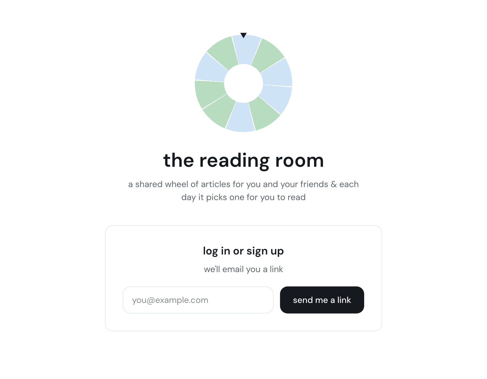

# the reading room 📚

a shared reading wheel for you and your friends. everyone in a room adds links, and each day a wheel picks one article for the whole room to read.

**try it at [read.sedinam.com](https://read.sedinam.com).** sign up with your email, start a room and send the invite link to a friend.

<p align="center">
  
</p>

- each link is one slice of the wheel. your own links are pale blue and everyone else's are green, however many people are in the room.
- you can't see other people's titles until their link is picked.
- the first person to open the app each day spins. the pick is locked for everyone until tomorrow.
- mark the article as read to see who else has. a link leaves the wheel once everyone has read it.

## stack

- **next.js 16** (app router, typescript, tailwind)
- **supabase** for the database, magic-link login and row level security
- **vercel** for hosting

## run it locally

1. install dependencies:

   ```
   npm install
   ```

2. create a free project at [supabase.com](https://supabase.com). in project settings → api, copy the project url and the anon public key into `.env.local`:

   ```
   NEXT_PUBLIC_SUPABASE_URL=...
   NEXT_PUBLIC_SUPABASE_ANON_KEY=...
   ```

3. set up the database: run each file in `supabase/` in the supabase sql editor, in order from `01` to `08`.

4. set up login in supabase → authentication:
   - **sign in / providers:** turn email on, and allow new users to sign up.
   - **url configuration:** set the site url to `http://localhost:3000` and add `http://localhost:3000/**` to the redirect urls.

5. start the app and open [http://localhost:3000](http://localhost:3000):

   ```
   npm run dev
   ```

## deploy

1. import the repo on [vercel.com](https://vercel.com) and add the two `NEXT_PUBLIC_SUPABASE_...` environment variables.
2. in supabase → authentication → url configuration, set the site url to your vercel address and add `https://your-app.vercel.app/**` to the redirect urls.

every push to `main` then updates the live site.

## how it's built

| where | what it does |
| --- | --- |
| `app/page.tsx` | the homepage: the wheel and spin before today's pick, the article card after it |
| `app/login/`, `app/auth/callback/` | magic-link login |
| `app/join/` | joining a room from an invite link |
| `app/api/fetch-title/` | server route that reads an article's title, description and image |
| `proxy.ts` | keeps the login fresh and sends logged-out visitors to `/login` |
| `components/` | the wheel, today's card, your links, the invite box and the header |
| `supabase/` | every table, rule and database function, in the order they were added |

the rules about who can see what live in the database, not in the page:

- **rooms:** row level security limits every table to your own room.
- **secret titles:** other people's unpicked links come back only as bare slices, from `wheel_slices()`, with no url or title.
- **the daily pick:** `spin()` runs in the database, and a unique rule allows one pick per room per day. if two people spin at once, only one pick is saved and both see it.

## how this was made

this app was built entirely by prompting claude, using claude opus 5.5 throughout. i didn't write any of the code by hand. it was a test of my prompting: how far good direction can take a real, deployed app.

- **claude chat:** shaping the idea and the build plan, going back and forth on what to build.
- **claude design:** the look and every screen.
- **[claude code](https://claude.com/claude-code):** building it one step at a time, with me reviewing each change, testing it in the browser, and redirecting when something wasn't right.

some of the bigger decisions came out of that back-and-forth, like switching from a two-person allowlist to rooms anyone can start.
